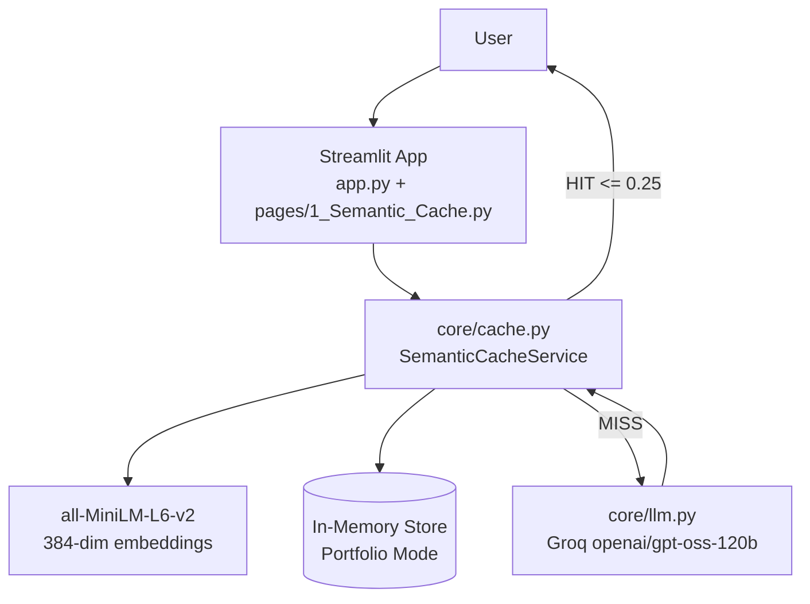

# Semantic Cache Assistant

A customer-support AI assistant that uses semantic caching to reduce redundant LLM API calls, improve response latency, and optimize inference costs.

The project demonstrates how vector embeddings, Redis vector search, and LLM integration can work together to build a cost-efficient AI application.

> **Live Demo:** https://semantic-cache-assistant.streamlit.app
>
> **Portfolio Note:** This project has two deployments with the same core logic.
> - **Production Mode:** FastAPI + Redis Stack (Docker) — full persistence, for GitHub / local demo
> - **Portfolio Mode:** Streamlit + In-Memory Cache — runs on Hugging Face Spaces (Free), no Docker needed
>
> If `REDIS_URL` is unavailable, the service automatically falls back to in-memory vector search using the same cosine-distance logic. No code change needed.

## Overview

Semantic Cache Assistant identifies semantically similar user queries and reuses previously generated responses instead of invoking an LLM for every request.

### How It Works

1. Generate an embedding for the incoming query.
2. Search Redis for semantically similar cached queries.
3. Return the cached response if a sufficiently similar match is found.
4. If no suitable match exists, invoke the Groq LLM.
5. Store the newly generated response in the semantic cache.
6. Record request metrics, including cache hits, cache misses, LLM calls, and latency.
7. Return the response to the user.

## Tech Stack

| Component | Technology | Cost |
|---|---|---|
| Backend | Python, FastAPI, Uvicorn | Free |
| Frontend | Streamlit (custom dark UI, `ui/` design system) | Free |
| Cache | Redis Stack, RedisVL (Production) / In-Memory NumPy (Portfolio) | Free |
| Embeddings | Sentence Transformers | Free, runs locally |
| Embedding Model | all-MiniLM-L6-v2 | Free, open-source |
| Embedding Dimensions | 384 | - |
| LLM Provider | Groq | Free Tier |
| LLM Model | openai/gpt-oss-120b | Free Tier via Groq |
| Environment Management | uv | Free |
| Testing | Pytest, HTTPX | Free |
| Code Quality | Ruff | Free |
| Data Analysis | pandas | Free |
| Infrastructure | Docker, Docker Compose (Production) / Hugging Face Spaces (Portfolio) | Free |
| Deployment | Hugging Face Spaces (Free Tier) | Free |

**100% Free Resources:** No paid APIs, no paid databases, no paid hosting. Embeddings run locally, LLM uses Groq Free Tier, hosting uses Hugging Face Spaces Free Tier.

## Architecture



### Production Mode (FastAPI + Redis)

```text
        User
          |
          v
    FastAPI Backend (/ask)
          |
          v
   Generate Embedding
          |
          v
  Redis Semantic Cache
          |
   +--------+--------+
   |                 |
Cache Hit         Cache Miss
   |                 |
   v                 v
Cached Answer    Groq LLM
                     |
                Generate Answer
                     |
                Store in Redis
   |                 |
   +--------+--------+
          |
          v
   Record Analytics
          |
          v
     User Response
```

### Portfolio Mode (Streamlit Cloud - Live)

```text
        User
          |
          v
   Streamlit App (Live)
   app.py + pages/ + ui/
          |
          v
  core/cache.py
          |
          v
   Generate Embedding
   all-MiniLM-L6-v2
          |
          v
  In-Memory Cache
          |
   +--------+--------+
   |                 |
Cache Hit         Cache Miss
   |                 |
   v                 v
Cached Answer    Groq LLM (core/llm.py)
                     |
                Store in Memory
```

Full details: `docs/architecture.md`

**Cache Hit**

- Convert the incoming query into an embedding.
- Search Redis for a sufficiently similar cached query.
- Return the previously generated response.
- Avoid making a new LLM request.
- Record a cache hit in analytics.

**Cache Miss**

- Convert the incoming query into an embedding.
- Search Redis and find no sufficiently similar cached query.
- Forward the request to the Groq LLM.
- Store the generated response in Redis.
- Record a cache miss and an LLM call.
- Return the generated response.

## Frontend (Streamlit UI v2)

The Streamlit app is a two-page, dark "cache console" UI. Lime means a cache **HIT** (free), amber means a **MISS** (paid LLM call).

| Area | What it does |
|---|---|
| **Overview** (`app.py`) | Landing page: what semantic caching is, a 3-step explainer, and the three demo questions with their expected HIT / MISS result. |
| **Playground** (`pages/1_Semantic_Cache.py`) | Ask a question, then see the trace, history and analytics. |
| **Trace** | A four-step pipeline (embed, search, decide, serve or call Groq) plus a gauge that pins the match **distance** against the **threshold** on one scale, with latency and the matched question. |
| **Analytics** | Total requests, hit rate (with bar), LLM calls saved, cache entries. |
| **Sidebar** | Brand header, Overview / Playground navigation with the active page highlighted, threshold slider, Clear Cache, eval table, status card. |

### Model-loading experience

The first visit has to import PyTorch / sentence-transformers and load `all-MiniLM-L6-v2` (about 90 MB on first run). The loader (`ui/loader.py`) makes that wait visible and non-blocking:

- The loading card appears immediately. Heavy imports run in a background thread, so the page is never blank.
- Three phases: **1 libraries**, **2 model**, **3 seed**, with a live log.
- On a first run the progress bar follows the **real bytes** written to the Hugging Face cache. If the model is already cached it skips the download step.
- Loading does not block navigation. You can switch pages mid-load; coming back resumes the same job instead of restarting it.

### UI code layout

- `ui/theme.py`: the design system (CSS variables, hero, trace, gauge, tiles, sidebar). Every page calls `apply_theme()` once.
- `ui/loader.py`: the boot loader described above.
- `.streamlit/config.toml`: dark theme and `showSidebarNavigation = false` (the app renders its own sidebar nav).
- `core/` and `backend/` are unchanged by the UI work.

### Deploying UI updates (Streamlit Community Cloud)

The live app at https://semantic-cache-assistant.streamlit.app is built from this repository, so updates ship by pushing code:

1. Push (or merge) your changes to the branch the Streamlit app is configured to deploy, normally `main`, with main file `app.py`.
2. Streamlit Cloud detects the new commit and redeploys automatically, usually within a minute or two. No manual step is needed.
3. `GROQ_API_KEY` stays in the app's Secrets and is unaffected.
4. If you push to a feature branch, the live URL does not change until it is merged, or the app's branch is switched in **Manage app → Settings**.
5. If the page looks stale after a deploy, use **Manage app → Reboot app** and hard-refresh the browser (Ctrl+F5).

> After a cold start or reboot the first visitor sees the loading card while the model downloads. Later visits reuse the cached model.

## Project Structure

```text
semantic-cache-assistant/
│
├── backend/
│   ├── app/
│   │   ├── api/
│   │   │   └── routes/
│   │   │       ├── health.py
│   │   │       ├── chat.py
│   │   │       ├── cache.py
│   │   │       └── analytics.py
│   │   ├── core/
│   │   │   ├── config.py
│   │   │   └── exceptions.py
│   │   ├── dependencies/
│   │   │   └── resources.py
│   │   ├── schemas/
│   │   │   ├── health.py
│   │   │   ├── chat.py
│   │   │   ├── cache.py
│   │   │   └── analytics.py
│   │   ├── services/
│   │   │   ├── semantic_cache.py
│   │   │   ├── vectorizer.py
│   │   │   ├── llm.py
│   │   │   ├── chat.py
│   │   │   └── analytics.py
│   │   └── main.py
│   └── tests/
│       ├── test_health.py
│       ├── test_chat.py
│       ├── test_chat_service.py
│       ├── test_cache.py
│       ├── test_analytics.py
│       ├── test_analytics_api.py
│       └── test_llm.py
│
├── core/                  # Portfolio: Shared logic for HF Spaces
│   ├── cache.py           # Copy of semantic_cache logic, no FastAPI
│   └── llm.py             # Groq wrapper (Free Tier)
│
├── pages/
│   └── 1_Semantic_Cache.py # Portfolio page: Playground + Trace + Analytics
│
├── ui/                    # Streamlit UI v2 (frontend only)
│   ├── __init__.py
│   ├── theme.py           # Design system: CSS, hero, trace, gauge, tiles, sidebar
│   └── loader.py          # Non-blocking model-loading progress card
│
├── .streamlit/
│   └── config.toml        # Dark theme + custom sidebar navigation
│
├── app.py                 # Portfolio entry point (Streamlit Overview)
├── data/
├── scripts/
│   ├── evaluate_threshold.py
│   ├── benchmark_latency.py
│   └── plot_benchmark.py
├── results/
│   ├── benchmark_latency.csv
│   └── benchmark_latency.png
├── .env.example
├── .gitignore
├── .python-version
├── README.md
├── docker-compose.yml
├── pyproject.toml
└── uv.lock
```

## Getting Started

### Prerequisites

- Python 3.13
- uv
- Docker Desktop (only for Production Mode)
- Groq API key (Free Tier: https://console.groq.com)

### 1. Clone the Repository

```bash
git clone https://github.com/siddhantjain603/semantic-cache-assistant.git
cd semantic-cache-assistant
```

### 2. Install Dependencies

```bash
uv sync --dev
```

### 3. Configure Environment Variables

Create your local environment file:

```bash
cp .env.example .env
```

Add your Groq API key:

```env
GROQ_API_KEY=your_groq_api_key
```

| Variable | Default / Purpose |
|---|---|
| `APP_NAME` | Semantic Cache Assistant |
| `APP_VERSION` | 0.1.0 |
| `DEBUG` | True |
| `REDIS_URL` | redis://localhost:6379 |
| `GROQ_API_KEY` | Your Groq API key (Free Tier) |
| `GROQ_MODEL` | openai/gpt-oss-120b |
| `EMBEDDING_MODEL` | sentence-transformers/all-MiniLM-L6-v2 |
| `EMBEDDING_DIMENSION` | 384 |
| `CACHE_NAME` | semantic-cache-assistant |
| `CACHE_DISTANCE_THRESHOLD` | 0.25 |
| `CACHE_TTL` | 86400 seconds |

> Threshold is **0.25**, not 0.30. See Evaluation Results below for why.

Never commit your actual `.env` file or API keys to GitHub.

### 4. Start Redis (Production Mode Only)

```bash
docker compose up -d
```

Verify the Redis container:

```bash
docker ps
```

Verify Redis connectivity:

```bash
docker exec -it semantic-cache-redis redis-cli ping
```

Expected output:

```text
PONG
```

> **Portfolio Mode:** Skip this step. If Redis is not available, the app automatically uses in-memory cache. This is how it runs on Hugging Face Spaces (Free).

### 5. Start the Backend

```bash
uv run uvicorn backend.app.main:app --reload
```

Backend URL: `http://127.0.0.1:8000`

Swagger API documentation: `http://127.0.0.1:8000/docs`

### 6. Run the Streamlit App (Portfolio UI)

```bash
uv run streamlit run app.py
```

Open the URL shown in the terminal (usually `http://localhost:8501`) and click **Playground** in the sidebar. On the first run you will see the loading card while the embedding model downloads. Set `GROQ_API_KEY` in your environment to get real answers on a MISS; without it the app returns a demo answer.

### 7. Run Tests

```bash
uv run python -m pytest backend/tests/ -v
```

Run code-quality checks:

```bash
uv run ruff check .
```

### 8. Run Evaluation

```bash
uv run python scripts/evaluate_threshold.py
```

### 9. Run Benchmark (100+ entries)

```bash
uv run python scripts/benchmark_latency.py
uv run python scripts/plot_benchmark.py
```

Outputs: `results/benchmark_latency.csv` + `results/benchmark_latency.png`

## API Endpoints

| Method | Endpoint | Description | Status |
|---|---|---|---|
| GET | `/health` | Application health check | Implemented |
| POST | `/chat` | Submit a question and retrieve a cached or generated answer | Implemented |
| GET | `/cache` | Retrieve cached entries with pagination | Implemented |
| GET | `/analytics` | Retrieve cache and request analytics | Implemented |

### 1. Health Check

```http
GET /health
```

Checks application health.

### 2. Chat API

```http
POST /chat
```

Request:

```json
{
    "question": "What is semantic caching?"
}
```

Example response:

```json
{
    "answer": "Semantic caching stores and retrieves responses using semantic similarity.",
    "cache_hit": false,
    "matched_question": null,
    "distance": null
}
```

| Field | Description |
|---|---|
| `answer` | Generated or cached answer |
| `cache_hit` | Whether the response came from the cache |
| `matched_question` | Original cached question when a match exists |
| `distance` | Semantic distance of the matched cache entry |

### 3. Cache Management API

```http
GET /cache
```

Retrieves cached entries from Redis with pagination.

| Parameter | Default | Constraints |
|---|---:|---|
| `offset` | 0 | Greater than or equal to 0 |
| `limit` | 20 | Between 1 and 100 |

Example:

```http
GET /cache?offset=0&limit=20
```

Example response:

```json
{
    "entries": [
        {
            "id": "cache:example",
            "question": "What is semantic caching?",
            "answer": "Semantic caching stores responses for similar queries.",
            "inserted_at": 1795341127.36,
            "updated_at": 1795341127.36
        }
    ],
    "total_entries": 1,
    "returned_entries": 1,
    "offset": 0,
    "limit": 20
}
```

| Field | Description |
|---|---|
| `entries` | Retrieved cache records |
| `total_entries` | Total number of indexed cache records |
| `returned_entries` | Number of records in the current response |
| `offset` | Current pagination offset |
| `limit` | Maximum records requested |

### 4. Analytics API

```http
GET /analytics
```

Returns application-level request and cache analytics.

Example response:

```json
{
    "total_requests": 10,
    "cache_hits": 7,
    "cache_misses": 3,
    "llm_calls": 3,
    "hit_rate": 70.0,
    "miss_rate": 30.0,
    "total_latency_ms": 2500.0,
    "average_latency_ms": 250.0
}
```

| Field | Description |
|---|---|
| `total_requests` | Total requests processed |
| `cache_hits` | Requests served from cache |
| `cache_misses` | Requests requiring LLM fallback |
| `llm_calls` | Number of LLM calls |
| `hit_rate` | Percentage of cache hits |
| `miss_rate` | Percentage of cache misses |
| `total_latency_ms` | Accumulated request latency |
| `average_latency_ms` | Average request latency |

Analytics are stored separately in Redis using a dedicated analytics key, so clearing the semantic cache through its cache-management mechanisms does not automatically erase analytics data.

## Error Handling

The application uses centralized exception handling in FastAPI.

The following service errors are translated into HTTP 503 responses:

| Exception | Source |
|---|---|
| `ServiceUnavailableError` | Application services |
| `RedisError` | Redis client |
| `RedisSearchError` | RedisVL search operations |

Example error response:

```json
{
    "detail": "A required service is currently unavailable."
}
```

The application also validates pagination parameters and returns HTTP 422 for invalid values.

## Evaluation Results

### Threshold Selection

Evaluated with `scripts/evaluate_threshold.py` on 13 test queries:
- 6 true paraphrases (should HIT)
- 5 hard negatives like "reset username" vs "reset password" (should MISS)
- 2 easy negatives like "cook pasta" (should MISS)

| Threshold | TP | FP | FN | TN | Precision | Recall | F1 | Avg Lookup |
|---|---:|---:|---:|---:|---:|---:|---:|---:|
| 0.15 | 4 | 0 | 2 | 7 | 1.00 | 0.67 | 0.80 | 60.6ms |
| **0.25** | **5** | **1** | **1** | **6** | **0.83** | **0.83** | **0.83** | **54.4ms** |
| 0.30 | 5 | 3 | 1 | 4 | 0.62 | 0.83 | 0.71 | 55.6ms |
| 0.40 | 5 | 4 | 1 | 3 | 0.56 | 0.83 | 0.67 | 53.6ms |
| 0.50 | 6 | 4 | 0 | 3 | 0.60 | 1.00 | 0.75 | 53.0ms |

**Chosen Threshold: 0.25**

Why 0.25 and not 0.30 (old default)?
- At 0.30, we got 3 false positives — e.g., "reset username" incorrectly matched "reset password". In customer support, that's giving the wrong answer.
- At 0.15, we were too strict — missed 2 real paraphrases.
- At 0.25, we get the best balance: highest F1 score (0.83), only 1 FP and 1 FN.

> Initial testing with only easy negatives showed all thresholds 0.25-0.50 as perfect. Adding hard negatives revealed the real tradeoff. This is why eval datasets must include hard negatives.

### Benchmark: 100+ Entries (M4)

Run: `uv run python scripts/benchmark_latency.py` + `uv run python scripts/plot_benchmark.py`
Cache: PortfolioSemanticCache (in-memory), threshold 0.25

| Entries | Avg HIT | HIT rate | Avg MISS | MISS rate |
|---:|---:|---:|---:|---:|
| 10 | 38.5ms | 10.0% | 40.3ms | 100.0% |
| 50 | 54.7ms | 40.0% | 54.9ms | 100.0% |
| 100 | 57.7ms | 65.0% | 50.2ms | 100.0% |

[Benchmark: HIT rate and latency vs cache size](results/benchmark_latency.png)

Takeaway: HIT rate grows 10% → 65% as cache grows, latency stays ~50-58ms.
MISS rate stays 100% — no false positives even at 100 entries.
The saving is not lookup time, it is avoiding the ~2s LLM call.

**LLM calls avoided (at 65% HIT rate):** 650 per 1,000 requests, 6,500 per 10,000, 65,000 per 100,000.
**Time saved:** ~1.9s per HIT, ~21 min per 1,000 requests.
**Cost saved:** $0 on Groq Free Tier. Illustrative paid-model saving ~$2.28 per 1,000 requests at GPT-4o pricing ($2.50 / 1M input + $10 / 1M output, ~200 input + ~300 output tokens per request).

## Current Implementation Status

### Milestone 1 — Backend Foundation

**Status: COMPLETED**

- [x] Initialize project structure.
- [x] Configure Python environment using uv.
- [x] Install application and development dependencies.
- [x] Configure Redis Stack using Docker Compose.
- [x] Verify Redis vector search module.
- [x] Implement application configuration.
- [x] Implement shared Redis and embedding resources.
- [x] Initialize FastAPI application and lifespan management.
- [x] Implement health endpoint.
- [x] Implement RedisVL semantic cache.
- [x] Integrate Sentence Transformer embeddings.
- [x] Integrate Groq LLM fallback.
- [x] Implement lazy LLM client initialization.
- [x] Implement ChatService orchestration.
- [x] Implement chat request and response schemas.
- [x] Implement POST `/chat`.
- [x] Add automated health and chat API tests.
- [x] Verify exact-match cache hits.
- [x] Verify semantic cache hits using paraphrased queries.
- [x] Verify cache misses and LLM fallback through the live API.

### Milestone 2 — Cache Management and Analytics

**Status: COMPLETED**

- [x] Inspect RedisVL cache management and inspection APIs.
- [x] Design application-level cache statistics.
- [x] Track total requests.
- [x] Track cache hits and cache misses.
- [x] Calculate cache hit rate and miss rate.
- [x] Track LLM API calls.
- [x] Measure request latency.
- [x] Implement analytics service.
- [x] Implement GET `/analytics`.
- [x] Implement cached-entry inspection.
- [x] Implement pagination for cache entries.
- [x] Include total cache-entry count.
- [x] Implement GET `/cache`.
- [x] Handle uninitialized cache and service states.
- [x] Implement centralized Redis and RedisVL exception handling.
- [x] Add automated tests for cache and analytics APIs.
- [x] Verify HTTP 503 behavior for Redis failures.
- [x] Run complete backend test suite.
- [x] Run full-project Ruff checks.

**Milestone 2 verification:**

- 20 automated backend tests passing.
- Full-project Ruff checks passing.
- Redis and RedisVL error handling verified through API tests.
- Cache inspection and pagination verified.

## Development Roadmap

This is the project's master execution plan. Milestones should be completed in sequence unless a documented engineering dependency requires a change.

### Milestone 3 — Testing and Reliability

**Status: COMPLETED**

- [x] Add deeper unit tests for ChatService.
- [x] Test semantic cache hit behavior.
- [x] Test semantic cache miss behavior.
- [x] Test LLM fallback and response storage.
- [x] Test lazy LLM initialization.
- [x] Test Groq API failures and timeouts.
- [x] Test Redis connection failures against a real Redis instance.
- [x] Test invalid requests and edge cases.
- [x] Add integration tests for Redis and the complete request pipeline.
- [x] Evaluate concurrent requests and race conditions.
- [x] Improve error handling and application reliability.

**Milestone 3 verification:**

- 40 automated backend tests passing (39 + 1 concurrent test `test_ask_handles_concurrent_requests`).
- 12 tests in `test_chat_service.py` alone.
- 8 tests in `test_llm.py` covering auth, timeout, rate-limit, 500, connection error.
- Full-project Ruff checks passing.

### Milestone 4 — Evaluation and Benchmarking

**Status: COMPLETED**

- [x] Design a representative query evaluation dataset (with hard negatives).
- [x] Include exact-match queries.
- [x] Include semantically similar queries.
- [x] Include unrelated queries.
- [x] Evaluate different cosine-distance thresholds.
- [x] Measure cache hit rate and miss rate.
- [x] Measure false-positive and false-negative rates.
- [x] Measure semantic matching accuracy.
- [x] Document threshold selection and trade-offs (0.25 chosen, F1 0.83).
- [x] Compare cache-hit and cache-miss latency with 100+ entries.
- [x] Estimate LLM API calls avoided.
- [x] Estimate cost savings.
- [x] Generate benchmark reports and visualizations.

**Milestone 4 verification:**

- `scripts/benchmark_latency.py` run: 100 entries → HIT 57.7ms / 65% HIT rate, MISS 50.2ms / 100% MISS rate.
- `results/benchmark_latency.csv` + `results/benchmark_latency.png` generated via `scripts/plot_benchmark.py`.
- LLM calls avoided: 650 per 1,000 requests at 65% HIT rate.
- Time saved: ~1.9s per HIT. Cost: $0 on Groq Free Tier, ~$2.28 per 1,000 illustrative at GPT-4o pricing.

### Milestone 5 — Streamlit Frontend (Portfolio)

**Status: COMPLETED**

- [x] Build the main Streamlit application.
- [x] Build `pages/1_Semantic_Cache.py` for portfolio (Playground + Trace + Analytics).
- [x] Implement an interactive chat interface with HIT/MISS badge.
- [x] Connect the frontend to the FastAPI backend (Production) / core/cache.py (Portfolio).
- [x] Display cache-hit and cache-miss status.
- [x] Display matched questions and semantic distance.
- [x] Build a cache statistics dashboard.
- [x] Add cache management controls (Clear Cache).
- [x] Add threshold slider (default 0.25).
- [x] Improve UI usability and error handling.
- [x] UI v2 redesign: shared design system (`ui/theme.py`) and dark theme via `.streamlit/config.toml`.
- [x] Custom sidebar navigation with active-page highlight (replaces Streamlit's default page list).
- [x] Trace redesign: pipeline steps plus a distance-vs-threshold gauge.
- [x] Real model-loading progress (libraries / model / seed phases, live byte-level download progress).
- [x] Non-blocking load: page renders immediately and navigation works while the model loads.

**Milestone 5 verification:**

- Tested locally on `http://127.0.0.1:8502`.
- `What is semantic caching?` -> HIT, distance 0.0132, latency 422.2 ms.
- `Explain semantic cache` -> HIT (paraphrase).
- `How do I reset my username?` -> MISS (hard negative).
- Loading card with real progress replaces the old static status text, so the first model load is never blank.
- Clicking Overview during a model load returns to `/` immediately; returning to Playground resumes the same load.
- Font system (UI v2): Bricolage Grotesque (headings) + DM Sans (body) + IBM Plex Mono (numbers/code).

### Milestone 6 — Production Engineering and Deployment

**Status: COMPLETED (Portfolio Scope)**

Portfolio deployment is live. Production hardening items (logging, monitoring, rate limiting, CI) are documented as future work in M7 / Future Enhancements, not blockers for portfolio use.

- [x] Complete Docker Compose configuration.
- [x] Containerize the FastAPI backend (via Docker Compose, Production mode).
- [x] Deploy Portfolio version — Streamlit Community Cloud (Free Tier).
- [x] Attempted Hugging Face Spaces deploy — Space created (`sidj231405/semantic-cache-assistant`, `sdk: streamlit`), code pushed, but HF returned `403: cpu-basic quota limit` on restart. No other Spaces running. Switched to Streamlit Cloud with identical code, no code change.
- [x] Configure Redis persistence (Production only).
- [x] Add service health checks (`GET /health`).
- [x] Improve environment-based configuration (`.env.example`, `GROQ_API_KEY` via Streamlit Secrets).
- [x] Validate deployment configuration.
- [x] Perform end-to-end deployment testing.

**Milestone 6 verification:**

- Live URL: https://semantic-cache-assistant.streamlit.app
- Tested live: `What is semantic caching?` -> HIT, `Explain semantic cache` -> HIT (paraphrase), `How do I reset my username?` -> MISS (hard negative).
- `requirements.txt` added for Streamlit Cloud (`streamlit`, `sentence-transformers`, `groq`, `numpy`).
- Remaining production hardening (not required for portfolio): structured logging, monitoring metrics, API rate limiting, GitHub Actions CI.

### Milestone 7 — Documentation and Final Release

**Status: COMPLETED**

- [x] Create a complete system architecture diagram (`docs/architecture.md` + Mermaid in README).
- [x] Document application design and request lifecycle (see Architecture + Cache Hit/Miss above).
- [x] Document API endpoints and schemas (see API docs in README / `backend/`).
- [x] Document configuration and setup instructions (`.env.example`, Streamlit Secrets).
- [x] Document benchmark methodology and results (see Evaluation / Benchmarks).
- [x] Document design decisions and trade-offs (threshold 0.25, in-memory vs Redis).
- [x] Add demo walkthrough (below, text-only).
- [x] Perform final end-to-end verification (see verification below).
- [x] Publish a tagged GitHub release (`v1.0.0` — run tag commands after push).

**Demo Walkthrough (Live):**

1. Open https://semantic-cache-assistant.streamlit.app
2. Click **Playground** in the sidebar.
3. Ask: `What is semantic caching?` -> First run: MISS (Groq call), second run: HIT.
4. Ask paraphrase: `Explain semantic cache` -> HIT (distance <= 0.25).
5. Ask hard negative: `How do I reset my username?` -> MISS (distance > 0.25, Groq call).
6. Observe: HIT / MISS badge, the distance gauge against the threshold, latency, hit-rate tiles and the Clear Cache button.

**Milestone 7 verification:**

- `uvx ruff check .` -> All checks passed!
- `pytest -q` with `PYTHONPATH=.` -> 40 passed.
- `.env` + `.env.example`: `CACHE_DISTANCE_THRESHOLD=0.25`.
- Live: HIT / HIT-paraphrase / MISS verified on Streamlit Cloud.
- Architecture docs: `docs/architecture.md` + Mermaid diagram in README.

## Future Enhancements

Features not included in the current implementation but worth considering:

- Cache clearing endpoint.
- Cache expiration and TTL management controls.
- More detailed cache lookup latency tracking.
- LLM calls avoided and estimated cost savings.
- Configurable semantic distance threshold through the frontend.
- Detailed operational monitoring.

## Evaluation Metrics

The project will measure:

| Metric | Purpose |
|---|---|
| Cache hit rate | Percentage of requests served from cache |
| Cache miss rate | Percentage of requests requiring fallback |
| Semantic match accuracy | Correctness of semantic retrieval |
| False-positive rate | Incorrect cache matches |
| False-negative rate | Relevant matches missed by the cache |
| Cache lookup latency | Time spent searching Redis |
| LLM response latency | Time spent generating a new response |
| Overall response latency | End-to-end request time |
| LLM calls avoided | Reduction in external LLM requests |
| Estimated cost savings | Financial impact of caching |

Benchmark results will be added after the evaluation framework is implemented.

## Development Principles

To maintain engineering quality and avoid drifting from the project plan:

1. Complete milestones in the documented sequence.
2. Work incrementally and verify each implementation step.
3. Add automated tests for new functionality.
4. Run Ruff and the complete test suite before milestone completion.
5. Document important architectural decisions and trade-offs.
6. Commit and push completed milestones to GitHub.
7. Never mark a feature complete without testing it.
8. Keep benchmark claims backed by measured results rather than assumptions.
9. Use only free-tier resources for portfolio deployment (Groq Free, HF Spaces Free, local embeddings).

## License

This project is licensed under the MIT License.
